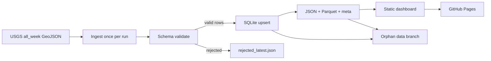

# Self-Updating Public Data Pipeline

I built this as a small, honest portfolio project. It is a Python pipeline that runs once a day on GitHub Actions, pulls the public USGS earthquake GeoJSON week feed (no API key), validates records, upserts only new and changed events into SQLite, exports JSON and Parquet, and rebuilds a static dashboard on GitHub Pages.

Live dashboard: https://rahul9121.github.io/self-updating-data-pipeline/

This is a demo, not an alerting service. Earthquake data is provided by the U.S. Geological Survey (USGS).

## What it does

- One polite request per run with a descriptive User-Agent, timeouts, and retries
- JSON Schema validation and rejected-record reasons
- Incremental load keyed by event id and `updated` time (new / updated / unchanged)
- Overlapping week window so re-runs exercise real upsert logic
- Run history, freshness, and a stale banner if the last success is older than 36 hours
- On failure, last good data and dashboard stay put; the failed run is recorded when possible
- Cron schedule plus manual `workflow_dispatch`
- State lives on an orphan `data` branch so scheduled bots never commit to `main`

## Architecture



## Run locally (3 commands)

```bash
python -m venv .venv
# Windows: .venv\Scripts\activate
# Unix: source .venv/bin/activate
pip install -r requirements.txt
python -m pipeline.run
```

Or with Make: `make setup`, `make run`, `make test`, `make site`.

Open `site/dist/index.html` in a browser after a successful run. Tests never hit the network; they use fixtures under `tests/fixtures/`.

```bash
pytest tests -q
```

## Schedule and state

The `Daily pipeline` workflow runs at **07:17 UTC** and can be started manually from the Actions tab. Concurrency group `daily-pipeline` prevents overlapping runs.

**State choice:** an orphan git branch named `data` holds `earthquakes.sqlite`, export JSON/Parquet, and run history. The workflow checks out `main` for code, restores files from `data`, runs the pipeline, and on success pushes only to `data` and deploys `site/dist` to Pages. `main` stays human-only. That keeps bot commits out of the default branch history and the contributors graph for the project code.

First run bootstraps an empty store (full week backfill from the feed). Later runs upsert against the overlapping window.

## Limitations

- GitHub may pause scheduled workflows on a public repo after about 60 days without repository activity. To re-enable: open the repo, push a small commit or use the Actions tab to run the workflow manually; schedules usually resume after activity.
- The week feed is a rolling summary, not a full historical archive.
- SQLite on a branch is fine for a demo, not a multi-writer warehouse.
- Pages deploys only after a successful run. A failure leaves the previous site as-is; freshness will eventually show stale.
- I cannot prove the cron fired until its next scheduled time; manual runs verify the same job path.

## License

MIT. See `LICENSE`.
